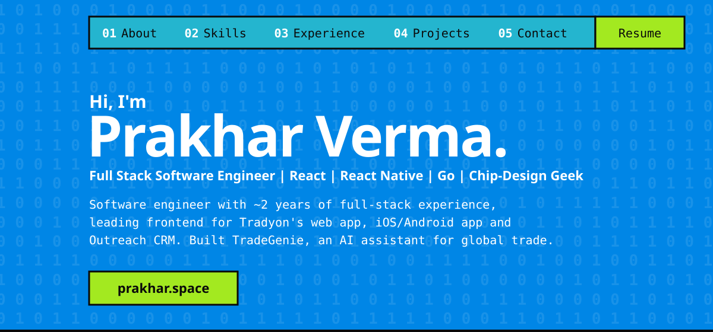

 

I studied Electronics and Communication Engineering at JIIT, and somewhere between wiring up sensors and building smart-home gadgets I realised I cared most about the part people actually touch: the interface.

These days I lead frontend at **[Tradyon](https://www.tradyon.ai)**, building across web and mobile, shaping the design system and working on AI features like **TradeGenie**. I also ship backend work in **Python/FastAPI** and **Go**.

The hardware side never left. I still tinker with electronics and explore chip design, from basic logic blocks up to **RISC-V** and **ASIC** principles.

 

| | |
|---|---|
| **Frontend & Mobile** |  React Native · Expo · Server-driven UI · TanStack Query · Zustand · TipTap |
| **Backend & Data** |  chi · pgx · Frappe · REST APIs · SQL |
| **Cloud & DevOps** |  CloudFront · S3 · ECS · Expo EAS · Docker Compose · Caddy |
| **AI** | Dify (LLM workflows) · prompt design · streaming chat over SSE · speech-to-text |
| **Design & Hardware** |  Design systems · Verilog · RISC-V · embedded C |

 

**Software Engineer · [Tradyon](https://www.tradyon.ai)** &nbsp;·&nbsp; *Dec 2024 – Present · Bengaluru*
- Lead frontend across the tradyon.ai web app, the iOS/Android app and Outreach CRM; top contributor to both frontend codebases, 170+ PRs reviewed.
- Built AI features end to end on Dify: **TradeGenie** (streaming answers, voice input, generated reports) and AI editing for email templates.
- Shipped 100+ PRs across 14 backend services (Python/FastAPI, Frappe, Java) and 12+ App Store / Play Store releases.

**Software Engineer Intern · Tokihub (formerly Bioquix)** &nbsp;·&nbsp; *Aug – Oct 2024*
- React + Redux interfaces, a Quill.js CMS on Supabase, and AWS (S3, CloudFront, Route 53) deploys.

 

| Project | What it is | Stack |
|---|---|---|
| **[TradeGenie](https://www.tradyon.ai/app-links)** | AI trade assistant on iOS, Android and web: find buyers in plain English, answers stream in as text, charts, maps and company cards. | React Native, Expo, Next.js, Dify |
| **[Outreach CRM](https://outreach.tradyon.ai)** | CRM for cross-border commodity traders: segments, enrichment, a TipTap email builder with AI editing, and a landed-price calculator. | React 19, TypeScript, TipTap, AG Grid |
| **[blog-svc](https://github.com/pro-khar/blog-svc)** | Self-hosted REST API in Go that serves the blog on prakhar.space. | Go, chi, pgx, PostgreSQL, Docker, Caddy |
| **[YARB](https://yarb.prakhar.space)** | Yet Another Resume Builder: one ATS-friendly template, no fuss. ([repo](https://github.com/pro-khar/resume-builder)) | React, TypeScript, shadcn/ui |
| **[RV32I core](https://github.com/pro-khar/RV32I_major)** | Single-cycle RISC-V (RV32I) core in Verilog. | Verilog |
| **[prakhar.space](https://prakhar.space)** | This portfolio. ([repo](https://github.com/pro-khar/me)) | React, TypeScript, Tailwind CSS |

 

